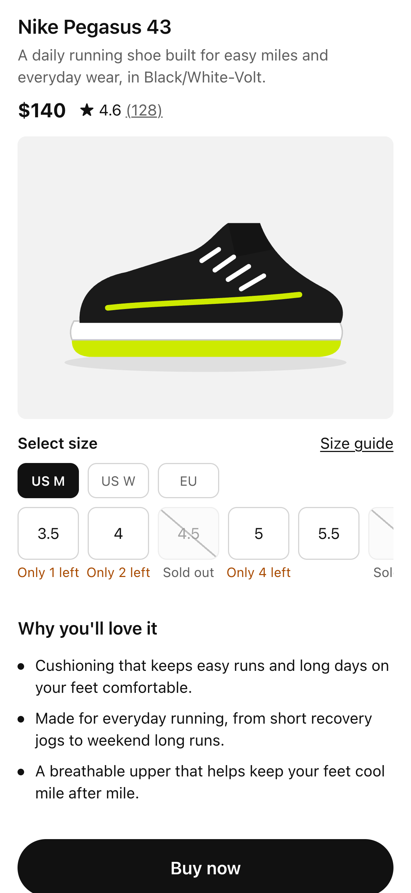
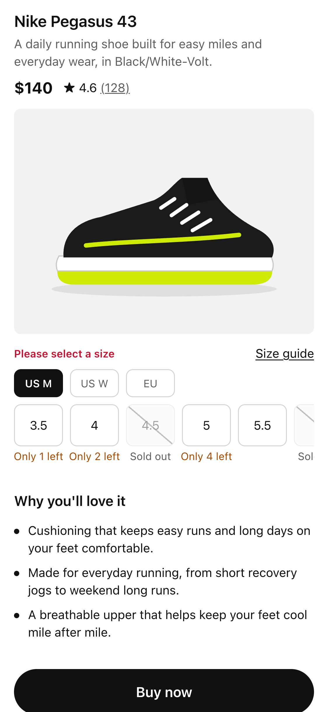
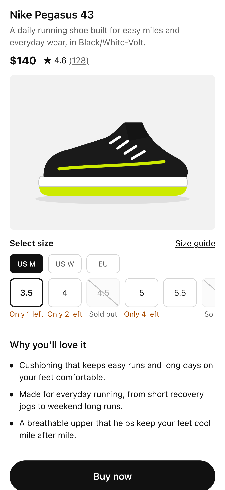
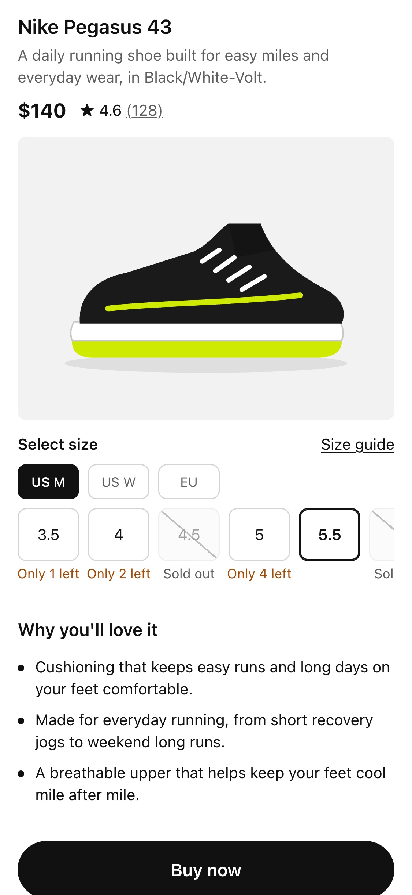
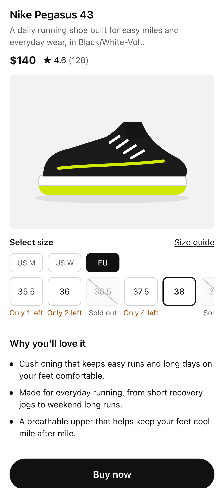
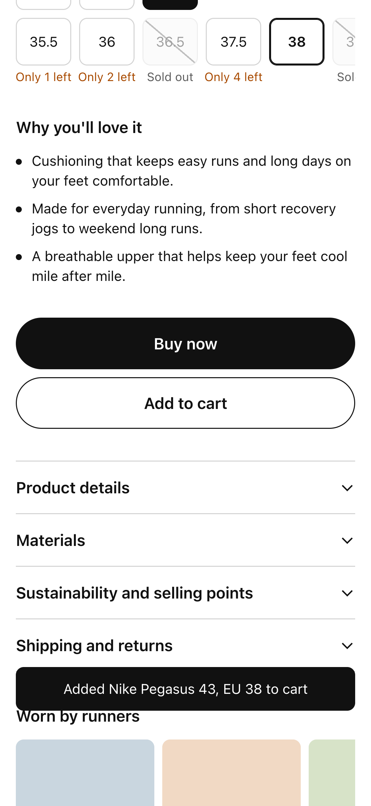

# Live size-tap test

Size taps and load checks on the live Vercel deployment, using the 8 December 2026 stock snapshot.

| | |
|---|---|
| Live URL | https://my-project-sable-seven-91.vercel.app/ |
| Deployed from | `main` after PR #3 (8 December 2026 stock snapshot) |
| Tested | 19 November 2026 |
| Device | Chrome DevTools phone emulation, 375×812, DPR 3, mobile + touch |
| Taps | Real clicks on each button through Chrome DevTools, not scripted `click()` calls |

## Lighthouse (live URL)

**Performance score: 99** (target 90 or higher)

Lighthouse 12.8.2, mobile, simulated throttling (150 ms RTT, ~1.6 Mbps, CPU 4×), run 19 November 2026.

| Metric | Value | Score |
|---|---|---|
| First Contentful Paint | 1.0 s | 1.00 |
| Largest Contentful Paint | 1.0 s | 1.00 |
| Total Blocking Time | 20 ms | 1.00 |
| Cumulative Layout Shift | 0 | 1.00 |
| Speed Index | 3.4 s | 0.89 |
| Server response (Vercel) | 30 ms | 1.00 |

Speed Index is the only metric below a full score. It measures how quickly the visible screen fills in, and it is higher here than on the local build (1.5 s). The live page reaches the 99 score anyway.

## Load trace (live URL, Slow 4G, CPU 4×)

| Metric | Value |
|---|---|
| TTFB | 564 ms |
| Largest Contentful Paint (main photo) | 1,187 ms |
| LCP render delay | 32 ms |
| Cumulative Layout Shift | 0.00 |
| Render-blocking requests | none (CSS is inlined) |

Only remaining DevTools insight: ~14 kB of legacy JavaScript (no effect on FCP or LCP).

## Size taps

The size grid stayed at **top 461 px, height 66 px** on load and after every tap (`size_grid_shift_px_max: 0`). One layout shift of 0.00017 was recorded, on the EU switch: the size numbers re-centre inside their buttons when the labels change from US to EU. The buttons and the grid did not move.

### 1. Page loaded

- "Select size", US M selected, no size selected.
- Stock from the 8 December snapshot: 3.5 "Only 1 left", 4 "Only 2 left", 4.5 "Sold out", 5 "Only 4 left", 5.5 in stock.
- 0 layout shifts on load.

### 2. Buy now with no size

- The label changes to **"Please select a size"** in red, in the same 20 px row. "Size guide" stays in place.
- The page scrolls back to the sizes and focus moves to the first available size (US M 3.5).
- Nothing is selected. Grid unchanged.

### 3. Tap 4.5 (sold out)

- 4.5 is greyed out and crossed through, and marked disabled for screen readers.
- The tap does not select it. The error stays. Grid unchanged.

### 4. Tap 3.5 (low stock)

- 3.5 is selected: bold number and a dark inset ring. The button stays 56×48 px.
- "Only 1 left" stays under it. The error clears back to "Select size".

### 5. Tap 5.5 (in stock)

- The selection moves from 3.5 to 5.5. Only one size is selected at a time.
- No stock note under 5.5, because it is in stock (9 pairs).

### 6. Switch to EU

- EU is selected. Labels change to EU sizes: 35.5, 36, 36.5, 37.5, 38.
- The selection carries over: US M 5.5 becomes **EU 38**.
- Stock notes are unchanged, and the buttons and grid do not move.

### 7. Add to cart

- Message: **"Added Nike Pegasus 43, EU 38 to cart"**, using the selected size in the selected size system.
- The message floats above the page and moves nothing. It disappears after 2.8 s.

## Budget check (`speed-budget.json`)

| Budget | Limit | Live result | Pass |
|---|---|---|---|
| `performance_score_min` | 90 | **99** | ✅ |
| `size_grid_shift_px_max` | 0 px | 0 px | ✅ |
| `size_button_min_px` | 48 px | 56×48 px (all 26 size buttons) | ✅ |
